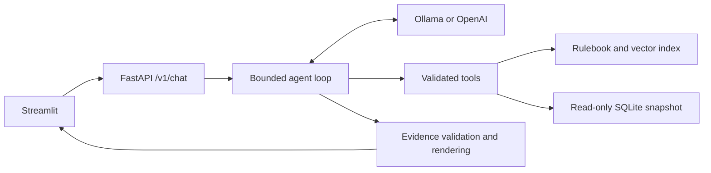

# DiceRP AI Agent

DiceRP is a Python assistant for a fictional FiveM roleplay server. It answers questions
from a sample rulebook, looks up synthetic player statistics, and reports a timestamped
server snapshot. The chat shows the exact rule excerpts, their file and line references,
and the tools invoked to answer each question.

Run the full application locally with Ollama, or switch to the OpenAI API using the same
agent, tools, and evidence checks.

## Features

- **Rulebook retrieval** ranks embedded handbook chunks by cosine similarity and cites
  their original text and line ranges.
- **Function calling** lets the model invoke `search_rules`, `get_player_stats`, and
  `get_server_status` within a fixed tool budget.
- **Read-only data access** uses parameterized SQLAlchemy queries over a synthetic
  SQLite snapshot.
- **Evidence validation** checks model-selected IDs before Python renders the answer.
  An invalid or empty selection produces an insufficient-evidence response.
- **Streamlit chat** displays sources and tool outcomes alongside each response.

## Technology stack

| Layer | Technology |
| --- | --- |
| Application and API | Python 3.12+, FastAPI, Pydantic |
| Chat and tool calling | Ollama Chat Completions with `qwen3:8b`, or the OpenAI Responses API |
| RAG | `qwen3-embedding:0.6b` or OpenAI embeddings, a local JSON index, cosine ranking |
| Structured data | SQLite and SQLAlchemy |
| User interface | Streamlit |
| Verification | pytest, Ruff, mypy, Python package builds, GitHub Actions |

## Architecture



`dicerp index` splits the rulebook into chunks that preserve their original line
ranges. At query time the agent can retrieve up to three candidates using embeddings
from the same provider and model used to build the index. It can also look up a demo
player or the server snapshot. The model selects evidence IDs from the tool results,
and the application renders the original excerpts and database values.

See the [architecture guide](docs/architecture.md) for the provider interfaces,
request flow, and engineering trade-offs.

## Windows quick start with Ollama

Install Python 3.12 or newer and [Ollama for Windows](https://docs.ollama.com/windows).
Start Ollama from the Start menu or run `ollama serve` if its local server is stopped.
Download the two models in PowerShell.

```powershell
ollama pull qwen3:8b
ollama pull qwen3-embedding:0.6b
ollama list
```

From the repository root, install the package and copy the sample configuration.
The example selects Ollama at `http://127.0.0.1:11434/v1`. It needs no API key.

```powershell
py -m venv .venv
.\.venv\Scripts\Activate.ps1
python -m pip install -e ".[dev]"
if (-not (Test-Path .env)) { Copy-Item .env.example .env }
```

Create the demo database once and build the rule index. Start FastAPI in the same terminal.

```powershell
dicerp seed
dicerp index
python -m uvicorn dicerp.api:create_app --factory --host 127.0.0.1 --port 8000 --no-proxy-headers
```

In a second terminal, activate the virtual environment and start Streamlit.

```powershell
.\.venv\Scripts\Activate.ps1
python -m streamlit run streamlit_app.py
```

Open the [chat UI](http://127.0.0.1:8501) or the [API docs](http://127.0.0.1:8000/docs).
If the first request times out while loading a model, check `ollama list` and adjust
`DICERP_OLLAMA_TIMEOUT_SECONDS` if needed. The default is 60 seconds per request, with
a maximum of 120 seconds. Run `ollama ps` to check GPU placement.

## Optional OpenAI configuration

In the ignored `.env`, set `DICERP_AI_PROVIDER=openai`, supply a development key in
`OPENAI_API_KEY`, and use `gpt-4.1-mini` for chat and `text-embedding-3-small` for embeddings.
Those model names are the defaults when the corresponding settings are omitted.
Environment variables override `.env`. OpenAI requests can incur usage charges.

Run `dicerp index` and restart FastAPI after changing the provider, embedding model,
or handbook. Startup rejects incompatible indexes. Use separate `DICERP_STATE_DIR`
directories to retain indexes for both providers, and seed each directory once.

## Example questions

| Question | Expected behavior |
| --- | --- |
| What counts as metagaming? | Retrieve the exact handbook excerpt and cite `conduct.txt`, line 10. |
| Show the stats for demo-001. | Return the synthetic player record, including 42 hours played. |
| How many players are online in the snapshot? | Return 17 of 64 players and the snapshot timestamp. |
| What is metagaming, and what is the server status? | Use both the rules and status tools in one turn. |
| What is the maximum number of items allowed in a glove compartment? | Abstain because the sample handbook does not cover that policy. |

## Testing

```powershell
python -m pytest
python -m ruff check .
python -m ruff format --check .
python -m mypy src tests streamlit_app.py
python -m build
```

The default suite uses isolated SQLite fixtures, deterministic embeddings, and mocked
provider HTTP calls. GitHub Actions is configured to run these checks on Python 3.12,
3.13, and 3.14.

With both Ollama models installed and the local server running, opt in to real model tests.

```powershell
$env:DICERP_RUN_OLLAMA_LIVE = "1"
python -m pytest -m ollama_live -v --tb=short
Remove-Item Env:DICERP_RUN_OLLAMA_LIVE
```

The OpenAI integration suite is separately opt-in. With an authorized development key
in `.env` or a path set in `DICERP_LIVE_ENV_FILE`, set `DICERP_RUN_LIVE=1` and run
`python -m pytest -m live -x -s --tb=short`. This suite can incur charges.

**Verified locally on Windows and Python 3.14.7:** 45 offline tests and 3 real Ollama
tests passed. Ruff, mypy, and wheel and source builds passed. The previous live OpenAI
attempt stopped on an exhausted credit balance. See the [test report](TEST_REPORT.md)
for the scenarios and results.

## Security and limitations

- The repository contains a sample handbook and synthetic player fixtures. Local
  environment files, credentials, databases, indexes, and caches are excluded.
- The documented services bind to loopback. Ollama requests stay on loopback. In
  OpenAI mode, the backend sends prompts and selected tool data to the API. Use
  fictional data with either provider.
- The backend validates tool names and arguments, limits tool executions, and opens
  the SQLite snapshot in read-only mode. The local service assumes trusted users
  and processes and has no multi-user authentication.
- Evidence validation prevents fabricated excerpts and values from being rendered.
  A model can still select a real but irrelevant excerpt or miss a relevant one.
  The integration tests cover selected prompts, and the chat handles each question
  independently.
- The corpus is intentionally small, and server status comes from a fixed snapshot.
  DiceRP has no connection to a live FiveM server.
