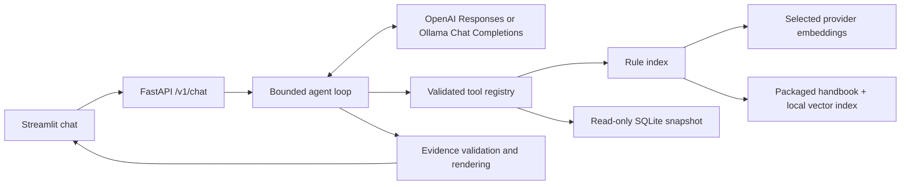

# Architecture and interview guide

## Why separate the agent and provider?

`agent.py` coordinates the request and validates the final selection. Its small model and
conversation interfaces make it possible to test decisions without a network call.
`openai_adapter.py` owns the SDK, tool schemas, and the Responses transcript. A function
call gets a corresponding `function_call_output` with the original call ID. The transcript
lives for one request, and Responses requests use `store=False`. OpenAI still processes
submitted prompts, queries, and tool results according to its API data policies.
[OpenAI function calling guide](https://developers.openai.com/api/docs/guides/function-calling)

`providers.py` selects a matched model and embedder for the API and indexing CLI.
`ollama_adapter.py` uses loopback HTTP and a Chat Completions transcript with assistant
tool calls and matching tool-role messages. It sends neither Responses-specific options
nor an OpenAI key. Tool-enabled local requests ask for an evidence JSON object in the
prompt, and the common renderer checks the result. The adapter accepts a single Markdown
JSON fence around that object to accommodate local model output.
[Ollama compatibility reference](https://docs.ollama.com/api/openai-compatibility)

The loop allows at most four tool executions and five model requests. Each upstream
request has a timeout and retries are disabled. Duplicate call IDs fail closed.
An unavailable upstream maps to HTTP 502, while an exhausted tool budget or unavailable
snapshot maps to HTTP 503. An Ollama timeout maps to HTTP 504. Responses omit raw upstream and database error details.

## How does RAG preserve source provenance?

`retrieval.py` splits the packaged handbook by rule heading and, if needed, groups complete
lines within a character limit. Every chunk carries a rule ID, file, inclusive one-based
line range, title, and verbatim excerpt. The indexing command embeds the title and excerpt
once and writes an atomic local JSON index. The corpus and model fingerprint and provider
metadata reject incompatible vectors on startup. Older indexes without provider metadata
are treated as OpenAI indexes. Source text always comes from the packaged handbook.

At request time, retrieval embeds the query with the same model and ranks the chunks by
cosine similarity. A stable ID breaks ties. A linear scan is easy to inspect and sufficient
for nine rules. The top three hits are candidates. Similarity alone cannot establish that
a rule answers the question. The model chooses relevant candidates or abstains.
[OpenAI embeddings reference](https://developers.openai.com/api/reference/resources/embeddings/methods/create)

## How are hallucinations handled?

The application validates the model's list of evidence IDs against the same schema for both providers. The renderer checks every ID
against successful tool results from this request and renders canonical excerpts and rows.
An invented ID, extra answer field, invalid response, or empty selection yields a fixed
abstention. This prevents fabricated excerpts, citations, and values from appearing in a
rendered answer. The model can still choose a genuine but irrelevant excerpt or omit a
relevant one. The deterministic tests cover the application boundary. They do not measure
live model relevance or abstention rates.
[OpenAI structured outputs guide](https://developers.openai.com/api/docs/guides/structured-outputs)

## Where is the write boundary?

`cli.py` can seed an isolated database from hard-coded fictional fixtures. The running
backend opens SQLite with URI `mode=ro` and enables `PRAGMA query_only`.
`db.py` uses fixed, parameterized SQLAlchemy SELECTs. `tools.py` validates the tool
name and arguments before dispatch. The only player input is an exact demo ID already
present in the question. The status response includes the snapshot timestamp and
a synthetic-data label.

The app is intended for a single local workstation. FastAPI checks the Host and chat
Origin, and both services bind to loopback in the documented setup. The OpenAI key is
read by the backend only. The local endpoints assume trusted local users and processes.

## What to show in an interview

- Trace a mixed rules-and-status request from the chat UI through two tool calls.
  Show how the final response obtains its values and line numbers.
- Open the invalid-evidence tests and explain what happens if the model returns an invented
  citation or tries to add its own answer text.
- Explain why document chunks are fingerprinted and why the corpus uses an exact linear
  scan. For a larger handbook, explain how you would measure retrieval recall and
  abstention on labeled questions before changing the index design.
- Show the test that disables `query_only` and still gets a SQLite write rejection.
  Explain the separate privileges of setup and runtime.
